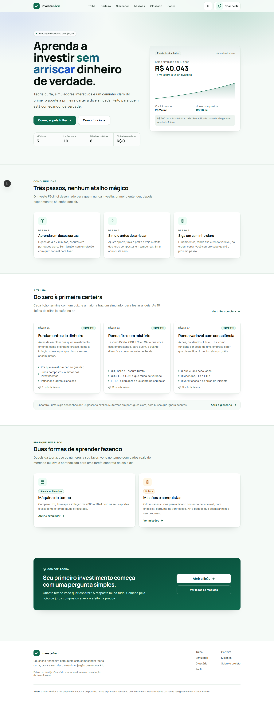
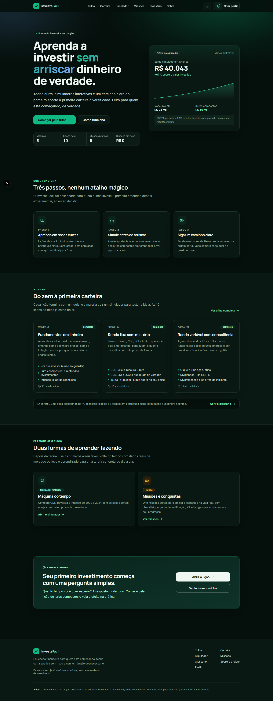
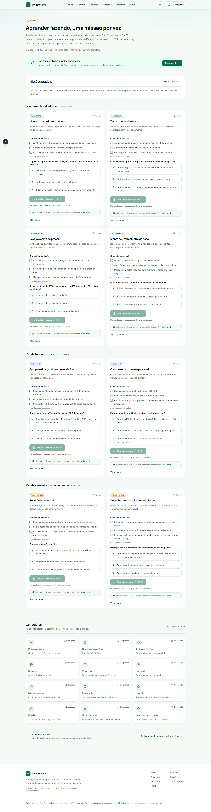

# Investe Fácil


Educação financeira para quem está começando: lições curtas, simuladores interativos e
progresso gamificado, sem cadastro, sem backend e sem dinheiro em risco.

Tema claro e escuro em todo o site, com visual de fintech premium e escolha manual de tema.

| Claro                                                 | Escuro                                                      |
| ----------------------------------------------------- | ----------------------------------------------------------- |
|  |  |



## O que é

O Investe Fácil é um site educacional que explica os fundamentos dos investimentos em uma
trilha curta, com linguagem simples e exemplos práticos. Cada lição termina em um quiz, e os
simuladores deixam o leitor testar cenários sem arriscar dinheiro real.

Todo o progresso fica no próprio navegador. Não existe login, banco de dados nem coleta de
dados pessoais.

## Para quem é

- Quem nunca investiu e quer entender o vocabulário antes de abrir uma conta
- Quem já investe, mas aprendeu por vídeos soltos e sente falta de uma base organizada
- Quem quer comparar produtos, prazos e riscos com números em vez de achismo

## O que você encontra

- **Trilha em 3 módulos** com 10 lições publicadas, de “por que investir” à renda variável
- **Simuladores** de juros compostos, inflação, risco × retorno, Tesouro × poupança,
  CDB × LCI, IR/IOF, dividend yield, propriedade e diversificação
- **Máquina do tempo** com CDI, Ibovespa e IPCA de 2000 a 2024, incluindo correção pela inflação
- **Carteira com benchmarks**: distribua aportes entre caixa, renda fixa, FIIs, ações e exterior,
  compare com CDI e Ibovespa, veja a queda máxima e baixe o relatório ano a ano em CSV
- **8 missões práticas** com checklist e pergunta de verificação antes de liberar o XP
- **12 conquistas** calculadas a partir do progresso, sem campo extra para manter no backup
- **Glossário com mais de 50 termos**, busca que ignora acentos e filtros por categoria
- **Quiz com correção e explicação** em cada lição
- **Até 3 perfis locais** com nome e avatar, cada um com progresso independente, sem cadastro,
  senha ou envio de dados
- **Troca de perfil** pelo cabeçalho ou pela página de perfis, com criação, edição e exclusão
- **Progresso persistente** no navegador, com XP, 8 níveis, aproveitamento nos quizzes e badges
- **Controle do progresso** no perfil ativo: apague uma missão ou lição específica, recomece a
  trilha, as missões ou todo o progresso, sempre com confirmação
- **Backup em JSON** com todos os perfis e o progresso para exportar e importar entre dispositivos
- **Tema claro, escuro e sistema** em todo o site, com escolha manual salva no navegador e
  preferência inicial do sistema operacional
- **Acessibilidade**: navegação por teclado, contraste AA nos dois temas, gráficos com descrição
  textual e respeito a `prefers-reduced-motion`

## Stack

| Camada    | Escolha                                                 |
| --------- | ------------------------------------------------------- |
| Framework | Next.js 16 (App Router) com `output: 'export'`          |
| Linguagem | TypeScript                                              |
| Estilo    | Tailwind CSS 4 com tokens em CSS variables              |
| Conteúdo  | MDX + registry tipado                                   |
| Estado    | Zustand com `persist` versionado                        |
| Validação | Zod                                                     |
| Testes    | Vitest + Testing Library (unitários) e Playwright (E2E) |
| Deploy    | Estático: Vercel, Netlify ou qualquer CDN               |

## Rodando localmente

```bash
npm install
npm run dev
```

Acesse http://localhost:3000.

```bash
npm run build     # gera o site estático em out/
npm run preview   # serve o build estático na porta 3000
npm run lint
npm run typecheck
npm test          # testes unitários
npm run test:e2e  # testes end-to-end (requer o build)
```

Para regenerar as capturas de tela com o servidor rodando:

```bash
node scripts/screenshot.mjs
```

O script gera as capturas nos dois temas e em desktop/mobile: `home.png` (claro) e
`home-dark.png` (escuro), além de `home-mobile.png` e `home-mobile-dark.png`. Ele grava o tema em
`localStorage` antes do primeiro render e falha se houver erro de console.

O tema e os tokens estão documentados em [`docs/design-system.md`](docs/design-system.md).

## Estrutura

```
app/                      rotas (landing, trilha, lição, carteira, simulador, missões, glossário, perfil, sobre)
components/
  charts/                 gráficos SVG sem dependências
  layout/                 cabeçalho, navegação desktop, menu mobile, tema e rodapé
  learn/                  quiz, progresso, missões, badges e navegação da trilha
  mdx/                    blocos reutilizáveis das lições
  profile/                perfis locais, avatares, troca de perfil e controle de reset
  sim/                    simuladores interativos, incluindo a máquina do tempo e a carteira
  ui/                     componentes base (botão, card, badge, progresso)
content/
  modules/                lições em MDX, versionadas no Git
  glossary.ts             verbetes, categorias e ligações entre termos
  history.ts              série anual de CDI, Ibovespa e IPCA (2000 a 2024)
  lessons.ts              metadados e ordenação da trilha
  missions.ts             missões práticas e perguntas de verificação
  profile.ts              avatares disponíveis para o perfil local
  quizzes.ts              perguntas, respostas e explicações
  registry.ts             mapeamento slug → componente MDX
lib/                      motores de cálculo, busca, XP, badges e store
docs/                     notas de aprendizado e design system
tests/e2e/                fluxos críticos em desktop, tablet e mobile
```

## Como foi construído

**Sem backend, de propósito.** Os perfis e o progresso vivem no `localStorage`, com schema
versionado e exportação em JSON. Cada perfil guarda XP, lições, quizzes, missões e badges
separados, e o primeiro perfil criado adota o progresso antigo de quem já usava o site. Isso
elimina banco, autenticação, custo de servidor e coleta de dados pessoais, e deixa o deploy em
uma CDN estática.

**Conteúdo em MDX versionado no Git.** Cada lição é um arquivo de texto. Revisar conteúdo é
abrir um pull request, e o build quebra se um componente ou link estiver errado.

**Motor financeiro separado da interface.** `lib/finance.ts`, `lib/history.ts` e
`lib/portfolio.ts` concentram as contas em funções puras, cobertas por testes. A UI apenas
consome os resultados.

**Gráficos próprios em SVG.** Para os simuladores atuais, um componente pequeno resolve sem
adicionar uma biblioteca de gráficos ao bundle. As séries usam `var(--chart-N)`, então a mesma
série muda de tom junto com o tema.

**Tema sem flash e sem dependência.** `lib/theme.ts` guarda a escolha em `localStorage`, e um
script inline no layout aplica a classe `.dark` antes da pintura. Os tokens semânticos em
`app/globals.css` trocam de valor entre `:root` e `.dark`, então a maior parte dos componentes não
precisa de nenhuma classe `dark:`.

## Aviso

Projeto educacional de portfólio. Nada aqui é recomendação de investimento. Todos os números
são ilustrativos e rentabilidades passadas não garantem resultados futuros.
